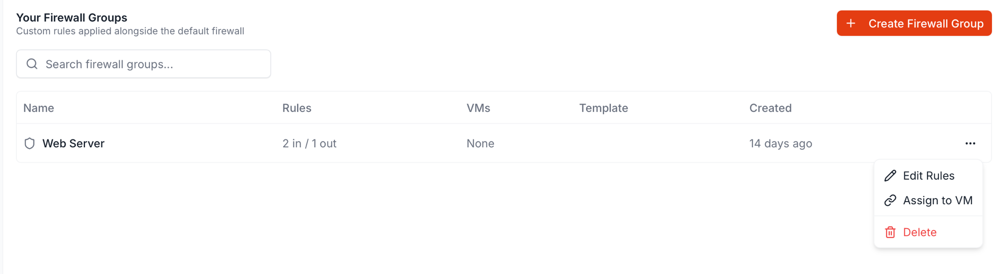
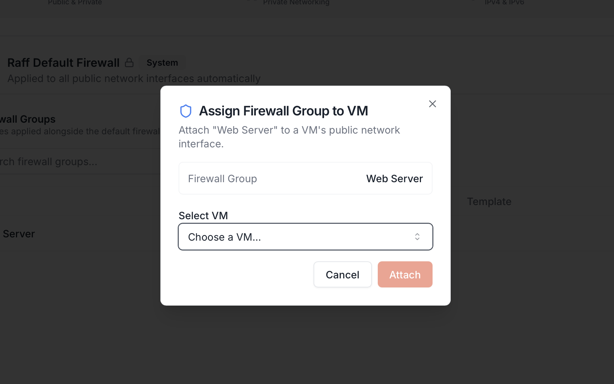
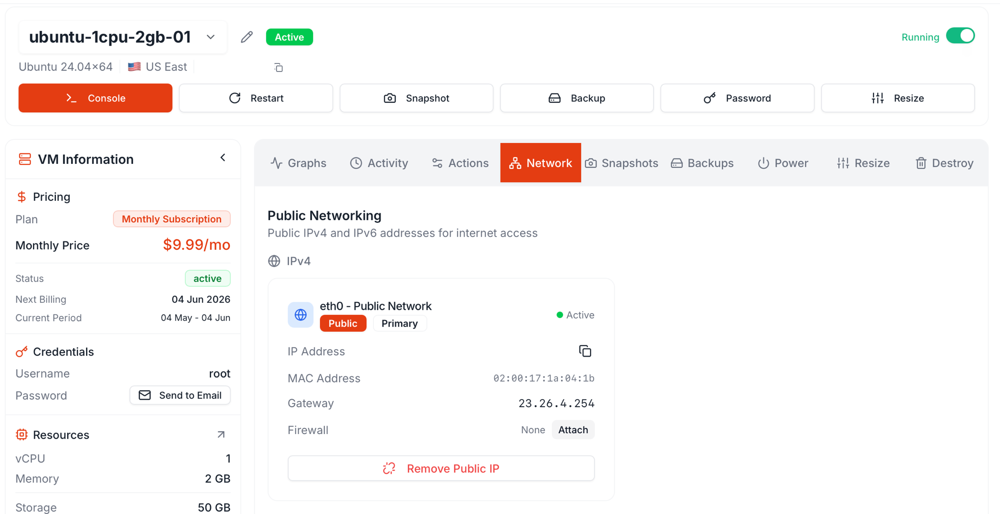

<sub>Updated November 10, 2026</sub>

A Firewall Group only filters traffic once it's **attached to a VM's public IP**. The group itself sits idle on the Firewall tab until you wire it up. There are two equivalent entry points; both produce the same result.

<Note>
**The rules apply when the attach finishes, in about 20 seconds, with no restart.** Connections that are already open stay open; every new connection follows the group's rules.
</Note>

## Path A — From the Firewall Groups list

This is the right path when you have a group already and want to apply it to one or more VMs.

In **Networking → Firewall**, find the group's row and click `⋮`.

<Frame>
  
</Frame>

The menu has three actions:

| Action | What it does |
|---|---|
| **Edit Rules** | Opens the same dialog used to create the group, prefilled with the existing rules. There's no separate view-only screen — Edit Rules is how you both inspect and modify a group |
| **Assign to VM** | Opens the attach dialog — pick a VM in the same region to apply this group to |
| **Delete** | Removes the group. Disabled if any VM still has it attached (detach first) |

Click **Assign to VM**. The Assign Firewall Group to VM dialog opens.

<Frame>
  
</Frame>

The dialog has two fields:

| Field | Notes |
|---|---|
| **Firewall Group** | Read-only — set to whichever group you opened the menu on (the screenshot shows `Web Server`). To attach a *different* group, cancel and reopen from that group's row |
| **Select VM** | Dropdown of every VM in the dashboard's selected region. Pick one |

Click **Attach**. The group is attached to that VM's **primary public IP** (typically the only one). The Firewall Groups row's **VMs** column now shows the count (e.g. `1 VM` instead of `None`), and the VM's Network tab shows the group name where `None` used to be.

To attach the same group to multiple VMs, repeat: open the row's `⋮` → **Assign to VM** → pick the next VM. Each Assign action attaches to one VM at a time.

## Path B — From the VM's Network tab

This is the right path when you're already on a VM's detail page and decide it needs a firewall.

Open the VM in **Compute** → click the **Network** tab. The IPv4 card has a **Firewall** field that reads `None` and an **Attach** button next to it.

<Frame>
  
</Frame>

Click **Attach**. A picker shows every Firewall Group in the account; pick one and confirm.

The card refreshes — the **Firewall** field now shows the group's name (with a Detach action where Attach used to be), and the group's row in **Networking → Firewall** updates its VMs count.

## Path C: Attach by Tag

This is the right path when a group of servers should share one firewall, now and when you add more. Link the Firewall Group to one or more [tags](/products/build/virtual-machines/concepts/tags-and-organization#tags-that-carry-a-firewall), and Raff puts it on the public IPs of every server in the group's project that has one of the tags.

```bash
raff tag create --name web --color blue
raff security-group tags set <sg-id> --tag-ids <tag-id>
raff vm tags add <vm-id> --name web
```

Linking runs in the background, about 20 seconds per server; `raff security-group tags get <sg-id>` shows the progress. A server tagged later gets the firewall the same way, and a server created with the tag starts with it. With the API, use [Set firewall tags](/api-reference/endpoint/set-firewall-tags); with Terraform, set `tag_ids` on [`raff_security_group`](/reference/terraform/raff_security_group).

## When it takes effect

Either path applies the group when the attach finishes, in about 20 seconds. There is no restart.

Connections that are already open stay open; every new connection follows the group's rules. A VM that is off gets the group when it starts.

Test from outside the VM with a new connection: `nmap -p <port> <ip>` from your laptop, or `curl` against the new ports.

If the dashboard says the server has not applied its rules yet, power the server off and on from its detail page.

## Detach later

Two equivalent paths, mirroring the attach options:

| From | How |
|---|---|
| **VM detail → Network tab** | Click **Detach** next to the Firewall field on the IP card |
| **Firewall Groups list** | Group row's `⋮` → **Assign to VM** picker → uncheck the VM (when this is supported), or open the VM and detach there |

Detaching takes effect in about 20 seconds, with no restart: the IP goes back to the Raff Default Firewall.

To switch one group for another (`web-prod-v1` → `web-prod-v2`), attach the new group. It replaces the old one on that IP, and the new group goes on before the old one comes off, so the IP is never left without a firewall.

## One Firewall Group per IP

Each public IP takes one Firewall Group. Attaching a group replaces the one the IP had. If 40 inbound and 40 outbound rules are not enough, combine ports into comma lists (`80,443`) and ranges (`3000:4000`).

Common pattern: one group per role (`web-prod`, `api-prod`), each with the essentials it needs (SSH from your office, DNS, NTP) plus the service's own ports. Edit a group and every VM using it gets the change.

## IP-version mismatch — what if the group's rules are IPv4-only and the VM is IPv6-only (or vice versa)?

A Firewall Group attaches to the VM's **public network interface**, not to a specific IP address. The same group covers both IPv4 and IPv6 traffic on that interface — but **only the rules whose source CIDR matches that traffic's family actually fire**:

| Group rules | VM public IPs | What actually happens |
|---|---|---|
| IPv4 rules only (`0.0.0.0/0`, `1.2.3.0/24`) | Dual-stack (IPv4 + IPv6) | IPv4 traffic filtered by your rules. **IPv6 traffic falls through the group entirely** — only the system Default Firewall applies. Effectively, the VM is wide-open on IPv6 except for the 5 default-blocked Windows ports |
| IPv4 rules only | IPv6-only VM | The group is **functionally a no-op**. None of your rules ever match IPv6 source addresses; only the Default Firewall is active. The dashboard lets you attach it but it does no work |
| IPv6 rules only (`::/0`, `2001:db8::/32`) | IPv4-only VM | Same — group is a no-op, only the Default applies |
| IPv6 rules only | Dual-stack | IPv6 filtered by your rules. **IPv4 wide-open** |
| Mixed (both v4 and v6 source CIDRs) | Dual-stack | Both protocols filtered correctly |
| Mixed | Single-stack VM | Only the rules matching the VM's actual IP family do anything |

**The common mistake** is copying an IPv4-only template (`Web Server`, `Database`, `SSH from Office`) onto a dual-stack VM and assuming it locked the box down — IPv6 is still wide-open. Either:

1. **Add the matching IPv6 source rows** to every inbound rule (`0.0.0.0/0` → also add `::/0`, `1.2.3.0/24` → also add the partner's IPv6 prefix), or
2. **Don't attach an IPv6 to the VM at all** — auto-assign IPv4 only, or detach the existing IPv6 from the VM's Network tab. With no IPv6 on the interface there's nothing for unfiltered IPv6 rules to expose.

For a real lockdown on a dual-stack VM, the safest pattern is: attach the group, then run `nmap -6 -Pn <ipv6-addr>` from outside to verify what's reachable on IPv6.

## What about VPC-only VMs?

A VM with no public IP cannot have a Firewall Group attached — there's nothing to attach to. The Network tab shows the IPv4 / IPv6 sections only when public IPs exist; the Attach button doesn't appear for VPC-only VMs.

To filter private VPC traffic, use guest-OS firewalls (`ufw`, `iptables`, Windows Firewall) on the destination VMs, or deploy a [Firewall Appliance](/products/network/vpc/quickstart-guides/manage-vpc#firewall-appliance-499-or-999--month) (OPNsense) as the VPC's gateway.

## Related

<CardGroup cols={3}>
  <Card title="Create a Firewall Group" icon="plus" href="/products/network/firewall/quickstart-guides/create-firewall-group">
    Build the rule set you'll attach.
  </Card>
  <Card title="Update rules" icon="pen" href="/products/network/firewall/quickstart-guides/update-rules">
    Edit a live group's rules.
  </Card>
  <Card title="Inbound vs outbound" icon="lightbulb" href="/products/network/firewall/concepts/inbound-vs-outbound">
    The model behind the rules.
  </Card>
</CardGroup>
