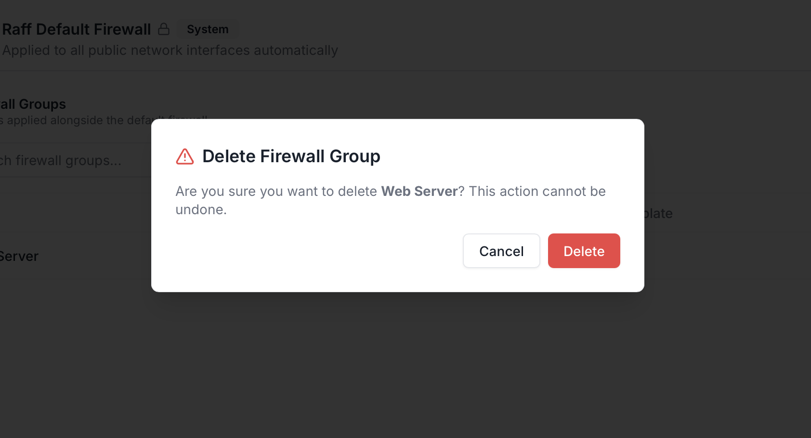

Updated November 5, 2026

Deleting a Firewall Group permanently removes the rule set from your account. The action is in the row's `⋮` menu and asks for a one-click confirmation — there's no soft-delete or recovery window. Use this when a group's no longer needed (decommissioned service, retired environment, replaced by a different group).

## Before you delete

| Rule | Why |
|---|---|
| **Detach the group from every VM first** | The Delete action is blocked while any VM has the group attached. The dashboard surfaces this as a disabled menu item or a blocked confirmation. Detach via the VM detail page → Network tab → IP card → **Detach** firewall, on every attached VM, before retrying the delete |
| **The system Default Firewall cannot be deleted** | The `Raff Default Firewall` card has no `⋮` menu and no Delete option. It's immutable. This page only covers Custom Firewall Groups |

## 1. Open the row menu

In **Networking → Firewall**, find the group's row in **Your Firewall Groups** and click the `⋮` on the right.

The menu has three actions on a Custom group: **Edit Rules**, **Assign to VM**, and **Delete** (red). Click **Delete**.

## 2. Confirm the delete

<Frame>
  
</Frame>

The confirmation dialog spells out the cost: *"Are you sure you want to delete **`<group-name>`**? This action cannot be undone."*

Click the red **Delete** to proceed, or **Cancel** to back out.

## What happens after delete

| Effect | Notes |
|---|---|
| **The group disappears from the Firewall Groups list** | Immediate — no soft-delete, no recovery |
| **Audit-log entry recorded** | `securitygroup.delete` — captures who deleted, when, the group ID and name. Visible to members with `account.audit.view` |

## When delete is blocked

If the menu item shows the Delete action greyed or the confirmation refuses to proceed:

| Blocker | Fix |
|---|---|
| **Group is attached to one or more VMs** | Open each VM's Network tab and Detach the firewall, then retry. The VMs column on the Firewall row tells you the count |
| **Trying to delete the Default Firewall** | Not possible — the system Default is permanent. Use a Custom group with `Deny All` rules attached over it for lockdown patterns |
| **Custom role missing the right permission** | Account permission `account.firewall.delete` (or whichever maps to it in your account's role catalog) is required. Owner and Admin have it; ask the Owner or grant via Custom role |

## Replacing a Firewall Group instead of deleting

To replace one group with another (e.g. swap `web-prod-v1` for `web-prod-v2` on a fleet of VMs):

1. **Create the replacement group** with the new rule set
2. **Attach the replacement** to every VM that has the old group. It replaces the old group on that IP in about 20 seconds, with no restart. The new group goes on before the old one comes off, so no VM is left without a firewall
3. **Delete the old group** (now unattached, the Delete action is unblocked)

## What you cannot do today

- **Recover a deleted Firewall Group** — once deleted, it's gone. Recreate from scratch
- **Bulk-delete groups** — one at a time from the row menu (or via the API)
- **Delete the Default Firewall** — system Default is immutable
- **Schedule a delete for later** — delete is immediate

## Related

<CardGroup cols={3}>
  <Card title="Update rules" icon="pen" href="/products/network/firewall/quickstart-guides/update-rules">
    Edit a group instead of deleting it.
  </Card>
  <Card title="Attach to a VM" icon="link" href="/products/network/firewall/quickstart-guides/attach-to-vm">
    Detach a group as the prerequisite to deleting.
  </Card>
  <Card title="Inbound vs outbound" icon="lightbulb" href="/products/network/firewall/concepts/inbound-vs-outbound">
    The model behind the rules you're deleting.
  </Card>
</CardGroup>
